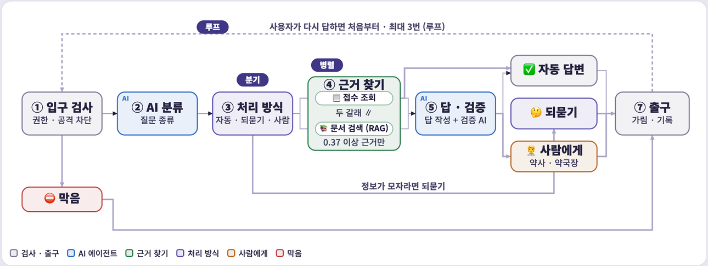
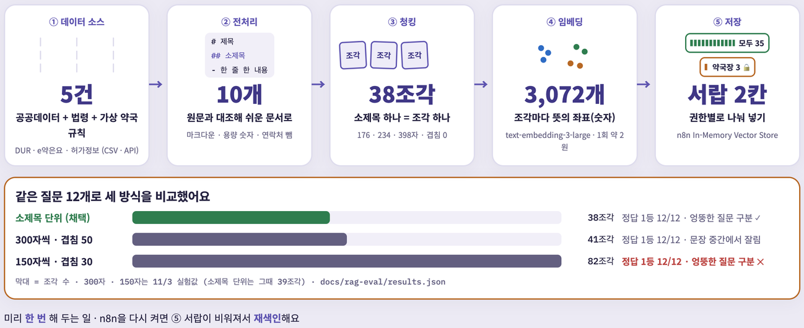
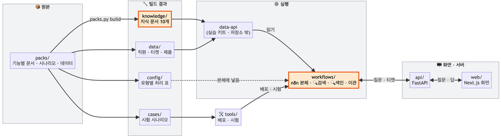

# 다정약국 · 창고형 약국 업무 도우미 

창고형 약국의 직원과 어르신 손님이 묻는 것을 n8n 워크플로우가 받아 처리하는 업무 지원 자동화입니다. **약국 문서에 근거가 있으면 바로 답하고, 사람이 정할 일은 약사 · 약국장에게 넘깁니다.** 
답은 약국 문서를 먼저 검색한 뒤 그 내용으로만 쓰는 방식(RAG)으로 만듭니다.

> 주제: 노코드 · 로코드 기반 기업형 지능형 기술 지원 자동화 (Tech Support)

| 이름 | 맡은 일 |
| --- | --- |
| 문태웅 (팀장) | 리드 · 통합, 시험 · 품질, 실행 결과서, Jira · Slack 연동 |
| **손영민 (부팀장)** | RAG (색인 · 검색), 지식 문서 검수, 최종 발표 |
| 한다영 | 오케스트레이션 (본체 워크플로우), 워크플로우 설계서 |
| 오병훈 | 연동 · 안정성 (이관 · 오류 처리), FastAPI 백엔드 |
| 차해든 | 고객 · 직원 · 약사 · 약국장 화면 제작 및 검증 (Next.js) |
<br>
> **제 기여** · RAG 색인 · 검색 설계 (청킹 3방식 비교 → 소제목 단위 채택, 권한별 색인 분리, 점수 기준 0.37 결정)  
> **결과** · 처음 보는 질문 21개 모두 정답 문서를 검색 결과 4위 안에서 찾음 · 권한 위반 0건  
> **기술** · n8n · OpenAI `text-embedding-3-large` (임베딩) · `gpt-4.1-mini` (분류 · 답 작성 · 검증) · n8n In-Memory Vector Store

<br>

## 왜 만들었나

창고형 약국은 직원이 많고 교대가 잦아서, 의약품 회수 작업 · 혼자 처리하는 마감 · 시니어 고객응대와 같은 **"교대 간 인수인계 미흡, 고객 응대로 인한 업무 지연"** 이러한 문제들이 있습니다. 이 도우미는 문서로 답할 수 있는 질문에는 근거와 함께 바로 답합니다. 약국 내에서 금전과 관련된 문제 · 약 판단 · 긴급 건은 반드시 약사 · 약국장에게 넘겨서, 약사는 판단에만 집중할 수 있습니다.

<br>

## 화면

| 직원: 회수 공지 문의 → 약사에게 긴급 이관 | 어르신: 큰 글씨 답 + 출처 + AI 고지 | 약사: 접수 목록 (긴급 먼저) |
| --- | --- | --- |
|  |  |  

## 무엇을 하나

| 문의 | 누가 묻나 | 도우미가 하는 일 | 사람이 정하는 일 |
| --- | --- | --- | --- |
| 회수 공지가 떴어요 | 직원 | 회수 첫 조치를 문서로 알려 주고 약사에게 긴급으로 넘김 | 회수 대상 확인, 손님 안내문자 승인 (약사) |
| 혼자 하는 첫 마감 | 직원 | 마감 순서를 문서로 답함 | 현금 차액 처리 (약국장) |
| 어르신 약 질문 | 어르신 (환자) | 공공 의약품 정보 문서를 인용해 답하고 AI 고지(AI가 정리한 안내라는 문구)를 붙임. 위험 신호가 보이면 약사에게 넘김 | 복약 판단 (약사) |
| 내 접수 건 확인 | 모두 | 본인 건만 보여 주고 연락처는 가림 | — |

<br>

## 흐름 한눈에



실제 n8n 노드 32개를 7단계로 묶은 그림입니다. 처리 방식에서 길이 갈라지는 곳이 **분기**, 근거 찾기의 두 갈래가 **병렬**, 위쪽 점선 되묻기(최대 3번)가 **루프**입니다. 공격 · 빈 질문은 입구에서 바로 막아 AI를 부르지 않습니다.

> ④의 **문서 검색**(RAG)은 손영민이 맡았습니다. 설계와 측정값은 [RAG 설계서](docs/RAG-ARCHITECTURE.md)에 있습니다.

자세한 노드 구성은 [워크플로우 설계서](docs/WORKFLOW-DESIGN.md)에, 검색 구조는 [RAG 설계서](docs/RAG-ARCHITECTURE.md)에 있습니다. 그림에 나온 이관 · 처리 방식 · DLQ 같은 말은 맨 아래 '용어'에 정리했습니다.

<br>

## 제 역할 

**RAG(문서 색인 · 검색) 설계와 구현, 지식 문서 검수, 최종 발표**를 맡았습니다.



문서를 미리 색인해 두는 과정입니다. 각 단계에서 무엇을 왜 골랐는지는 아래 표에 정리했습니다.

| 한 일 | 판단과 근거 | 파일 |
| --- | --- | --- |
| 청킹 방식 비교 후 **소제목 단위** 선택 | 소제목 단위 · 300자 · 150자 세 방식 모두 hit@3 12/12였습니다. 150자는 문서 밖 질문 점수가 정상 질문보다 높아져 점수 기준으로 거를 수 없었습니다(간격 −0.024). 소제목 단위는 청크 수가 가장 적고 소제목 하나가 완결된 근거가 됩니다 | [`team3-index`](workflows/team3-index.json) |
| 권한별 색인 분리 (**검색 전 필터**) | 약국장 전용 문서를 별도 메모리 키(`pharm_kb_v1_owner`)에 두어 직원 요청에서는 아예 검색하지 않게 했습니다. 직원 질문에서 약국장 문서가 나온 횟수는 0입니다 | [`team3-search`](workflows/team3-search.json) |
| `top_k` 4 · 점수 기준 `SCORE_MIN` 0.37 결정 | 정상 질문 1등 점수(0.378~0.641)와 문서 밖 질문 1등 점수(0.213~0.366)를 재서 그 사이로 정했습니다 | [RAG 설계서 3절](docs/RAG-ARCHITECTURE.md#3-임베딩) |
| **블라인드 질문**으로 재측정 | 팀이 쓴 질문에 맞춰 소제목을 다듬었기 때문에 시험이 유리할 수 있었습니다. 그래서 문서를 보지 않고 만든 질문 25개로 다시 쟀습니다 | [RAG 설계서 7절](docs/RAG-ARCHITECTURE.md#7-블라인드-질문으로-다시-잼-115) · [`rag_meta_eval.py`](tools/rag_meta_eval.py) |
| 지식 문서 검수 (10개) | 어르신용 문서를 식약처 e약은요 · DUR · 허가정보 원문과 대조해 일반약과 전문약 구분, 성분 표기를 바로잡았습니다 | [`knowledge/`](knowledge/) |

**결과**: 블라인드 25문항에서 문서로 답할 질문 21개 모두 정답 문서가 4위 안에 들었습니다(3회 반복 동일). 권한 위반은 0건, 어르신의 사실 질문을 약사에게 잘못 넘긴 건도 0건입니다 ([재측정 기록](runs/recheck-20261109.md)).

**남은 한계**: 정상 질문과 문서 밖 질문의 점수 간격이 0.012로 좁아 블라인드 질문에서는 두 분포가 겹쳤습니다. 그래서 문서 밖 질문은 분류 단계에서 먼저 거르고, 점수 기준은 두 번째 그물로 남겼습니다. 메모리 저장소라 n8n을 재시작하면 매번 다시 색인해야 하고, 색인 버전 확인은 구현하지 못했습니다. 운영한다면 PGVector 같은 지속형 저장소로 옮겨야 합니다.

<br>

## 시험 결과

팀 VM에서 잰 값입니다. 11/6에 새 기능 추가를 멈추고(기능 동결) 전체를 다시 시험했고, 제출일 11/9에 같은 절차로 한 번 더 재서 같은 결과를 확인했습니다. 시험 종류 · 날짜 · 결과 · 결과 파일을 한 장에 모은 목록은 [`runs/README.md`](runs/README.md), 숫자 해석과 실패 사례는 [실행 결과서](docs/EXECUTION-RESULT.md) 3 · 4절에 있습니다.

| 항목 | 결과 |
| --- | --- |
| 공통 시나리오 14유형 (판정 항목 20개) | 3회 모두 통과 (20/20 × 3) |
| 팀 시나리오 24개 · 처리 방식 세 갈래를 확인하는 시나리오 7개 | 24/24 × 3 · 7/7 × 3 |
| 장애 대응 (티켓 API 고장 · LLM 멈춤 · 느린 조회) | 3/3 × 3 — 고장 중에도 긴급 건은 약사에게 감 |
| 근거 없는 자동 답변 · 권한 위반 | 0건 · 0건 |
| 시나리오에 없던 질문 25개 (문서로 답할 질문 21 + 범위 밖 4)를 3번 | 3번 모두 같은 처리, 답할 질문 21개 모두 정답 문서가 검색 결과 4위 안에 듦 |
| 응답 시간 | 새 질문 중앙값 3.12초, 같은 질문을 다시 하면 0.12초 (배포 직후 첫 호출은 7.60초) |
| 동시 사용 | 30명이 동시에 물어도 실패 0 (중앙값 8.66초) |

남은 한계(배포 직후 첫 호출 지연, n8n 실행 기록에 연락처 원문이 남는 문제 등)는 [실행 결과서 4.2절](docs/EXECUTION-RESULT.md#42-남은-결함--잔여-위험-116-최종-회귀-기준)에 적었습니다.

<br>

## 제출 문서

| 문서 | 내용 |
| --- | --- |
| [주제 제안서](docs/TOPIC.md) · [팀 헌장](docs/TEAM-CHARTER.md) | 주제 · 범위 · 역할 · 규칙 |
| [워크플로우 설계서](docs/WORKFLOW-DESIGN.md) | 업무 시나리오, 흐름도, 분기 · 병렬 · 루프, 외부 연동, 노드 간 데이터, 오류 처리 |
| [RAG 설계서](docs/RAG-ARCHITECTURE.md) | 문서 · 청킹 · 임베딩 · 인덱스, 블라인드 질문 측정 |
| [실행 결과서](docs/EXECUTION-RESULT.md) | 시나리오별 시험 기록, 실행 로그, 실패 사례, 남은 결함 |
| [시험 기록 전체 목록](runs/README.md) | 무엇을 · 언제 · 몇 번 시험했고 결과가 어땠는지, 결과 파일 68개 위치 |
| [전체 설계 기준](00-DESIGN.md) | 계약(요청 · 응답 모양) · 권한 · 데이터 · 시나리오 |

<br>

## 폴더 구조



> 🔍 주황 테두리는 손영민이 맡은 부분입니다(`knowledge/` 검수, `workflows/`의 `team3-index` · `team3-search`). data-api는 강사 실습 키트의 서버라 이 저장소에는 없습니다.

| 그림 밖 폴더 · 파일 | 내용 |
| --- | --- |
| `00-DESIGN.md` | 전체 설계 기준 (계약 · 구조 · 권한 · 데이터 · 시나리오) |
| `docs/` | 제안서 · 헌장 · 설계서 2종 · 실행 결과서 · 데일리 · 화면 QA · RAG 측정 |
| `runs/` · `requests/` | 시험 보고서 · 시연과 bench 요청 |
| `contracts/examples/` | 부품 사이 연결마다 요청 · 응답 예시 (가짜 웹훅 · 화면의 가짜 응답 · pytest에서 씀) |
| `infra/` | docker compose로 data-api · api · web을 한 번에 띄움 |

<br>

## 바로 실행

아래 순서는 수업 실습 환경 기준입니다. n8n 2.42.6, 본인 OpenAI API 키, 강사 실습 키트의 연습용 data-api(`server.py`)가 있어야 합니다. 실습 키트는 수업 저장소에 있어 이 레포에는 들어 있지 않습니다.

```bash
# 1) 받기 — 강사 실습 키트 레포와 같은 폴더(홈)에
git clone https://github.com/encore-ai-campus/aio-01-p4-team3.git ~/aio-p4-3rd-team-pharm

# 2) 팀 설정 — infra/.env 만들기, n8n Credential 등록, data-api 켜기
cd ~/aio-p4-3rd-team-pharm && bash tools/setup.sh
#    처음 실행하면 infra/.env만 만들고 멈춥니다. TEAM3_KEY= 에 직접 정한 긴 문자열(팀 키)을 넣고 한 번 더 실행합니다.
#    팀 키는 웹훅 인증(X-Team-Key)과 API 인증(X-Api-Key)에 같이 쓰입니다.
#    infra/.env는 git에 올라가지 않습니다. 키는 이 파일에만 둡니다.

# 3) 지식 문서 · 데이터 · 시나리오 만들기 (packs/ → knowledge/ · data/ · cases/team.json · config/)
python3 tools/packs.py build && python3 tools/packs.py check

# 4) 워크플로우 올리고 색인 → 시험
uv run tools/flow.py push workflows/team3-*.json
uv run tools/flow.py call team3-index requests/empty.json
uv run tools/flow.py test cases/common.json --webhook team3-support -v
uv run tools/flow.py test cases/team.json -v
```

화면과 API를 한 번에 띄우는 방법은 [`infra/README.md`](infra/README.md)에 있습니다. 화면만 띄우려면 [`web/README.md`](web/README.md), 백엔드만 띄우려면 [`api/README.md`](api/README.md)를 보세요.

| n8n Credential (값은 n8n에만, 레포 · 문서에 쓰지 않음) | 쓰는 곳 |
| --- | --- |
| `OpenAI (.env)` (`openAiCourse0001`) | 채팅 `gpt-4.1-mini` · 임베딩 `text-embedding-3-large` |
| `team3WebhookKey` | 입구 웹훅 Header Auth (헤더 `X-Team-Key`) — `setup.sh`가 등록 |
| `team3ApiKey` | n8n이 FastAPI(`POST /tickets` · `/alerts`)를 부를 때 헤더 `X-Api-Key` — `setup.sh`가 등록 |
| `jiraAio3Cloud001` · `slackAio3Bot0001` | Jira 장애 티켓 · Slack 알림 (실제 모드에서만) |

`tools/flow.py`는 강사 실습 도구에서 팀 Credential만 허용 목록에 더한 버전입니다. 입구 웹훅을 부를 때 `X-Team-Key`를 붙입니다. 키 없이 부르면 n8n이 403을 돌려줍니다.

<br>

## 문제 해결

| 증상 | 할 일 |
| --- | --- |
| `call` 404 / 403 | push 했는지, `infra/.env`의 `TEAM3_KEY`가 n8n `team3WebhookKey` 값과 같은지 |
| 검색 결과가 항상 비어 있음 | push 하면 n8n이 재시작돼 색인이 사라짐 → `team3-index`를 다시 부름 |
| 장애 시나리오 뒤 다른 시나리오가 실패 | 장애 상태를 되돌림: `flow.py fault all ok` · `flow.py llm up` |
| `packs.py check` 실패 | 메시지에 나온 팩의 문서 · 시나리오 수를 채우거나 `packs/active.json`을 되돌림 |

<br>

## 용어

| 말 | 뜻 |
| --- | --- |
| 이관 | 사람에게 넘김 = 티켓 생성, 응답 `route: 담당자 이관` |
| 처리 방식 4개 | 자동 답변 (`auto`) · 근거 + 이관 (`evidence_handoff`) · 이관만 (`handoff_only`) · 접수 조회 (`record_status`). 본체는 유형 이름이 아니라 이 4개로 갈라짐. 흐름도와 시험 결과의 "세 갈래"(자동 답변 · 되묻기 · 사람에게)는 사용자가 받는 결과 기준으로 묶은 것 |
| 유형별 처리 표 (`Type policy`) | 유형마다 처리 방식 · 넘길 사람 · 위험 신호를 적은 표. 본체 안의 Code 노드 하나에 들어 있고, 원본은 `config/type-policy.json` |
| 팩 (pack) | 기능 하나를 켜고 끄는 파일 묶음. 예: `packs/recall/` = 회수 문서 2개 + 처리 표 한 줄 + 시나리오. 켜진 팩 목록은 `packs/active.json` |
| 계약 | 부품끼리 주고받는 데이터 모양 (요청 · 응답 칸, `route` 값, API 모양). `00-DESIGN.md` 2 · 3절 |
| 공통 · 팀 시나리오 | 공통 = 강사가 정한 14유형 (`cases/common.json`), 팀 = 우리 기능 시험 (`cases/team.json`) |
| data-api | 강사가 주는 연습용 가짜 회사 서버 (티켓 · 알림 · DLQ · 직원 · 문서). 공통 시나리오는 여기 남은 기록으로 통과 여부를 판정 |
| DLQ | 처리 못 한 요청을 잃지 않게 넣어 두는 대기열 (나중에 다시 처리) |
| 연습 · 실제 모드 | 연습 = Slack · Jira로 안 보냄 (레포 기본값), 실제 = 긴급 · 실패를 Slack, 장애를 Jira로 보냄 (팀 VM) |
